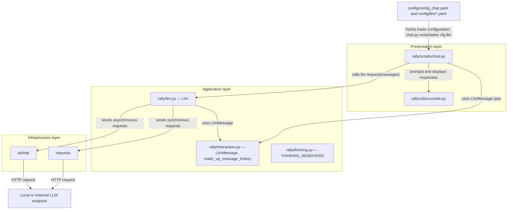

## rally constitution spec

### 1. Executive summary

#### 1.1. Project description

Rally is a Python library for interaction with and performance tests of local and external LLMs.

#### 1.2. Project motivation

Rally provides a reusable library for interaction with local and external LLMs. It supports shared request handling and performance testing across those models.

#### 1.3. Implementation repos

`rally` is the management repo and the only implementation repo.

#### 1.4. Architecture type

Layered architecture.

#### 1.5. Execution mode

Manual.

### 2. Requirement analysis

#### 2.1. Functional requirements

- **FR1 — Configure LLMs.** Users must be able to configure local and external LLM endpoints and their request settings through the project’s configuration system.
- **FR2 — Send requests.** The library must support synchronous and asynchronous requests to LLM endpoints.
- **FR3 — Send batches.** The library must support batch requests.
- **FR4 — Stream responses.** The library must support incremental streaming.

#### 2.2. Non-functional requirements

- **NFR1 — Failure tolerance.** The library must make failures during communication with an LLM endpoint visible to callers, rather than silently reporting them as successful responses.

#### 2.3. Preferences

- **P1 — Configuration.** Prefer explicit configuration through Hydra for executable scripts and LLM settings.
- **P2 — Dependencies.** Prefer focused, lightweight dependencies over reimplementing existing functionality.
- **P3 — Request ownership.** Keep LLM request construction and provider-specific response handling inside Rally.
- **P4 — Object-oriented design.** Organize components primarily around objects.

### 3. Acceptance criteria

An implementation meets the functional and non-functional requirements when:

- The project’s automated tests pass and cover FR1–FR4 and NFR1.
- The project’s configured linters and type checker pass.

Preferences are not acceptance criteria.

### 4. Insight

No insight provided at the beginning of the project.

### 5. Overall solution design

#### 5.1. High-level design

#### 5.2. Core components

- **Presentation layer**
  - `rally/scripts/chat.py` — loads the Hydra configuration, interacts with the user, and calls the configured `Llm`.
  - `rally/utils/console.py` — provides console input and output.
- **Application layer**
  - `rally/llm.py` — owns LLM settings and implements synchronous, asynchronous, batch, and streaming requests.
  - `rally/interaction.py` — defines `LlmMessage` and builds message histories.
  - `rally/thinking.py` — provides model-family-specific reasoning-removal functions.
- **Infrastructure layer**
  - `requests` — sends synchronous HTTP requests.
  - `aiohttp` — sends asynchronous HTTP requests.
